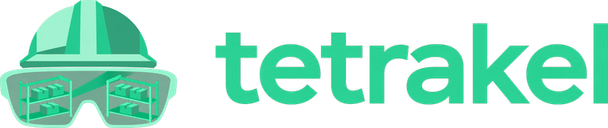
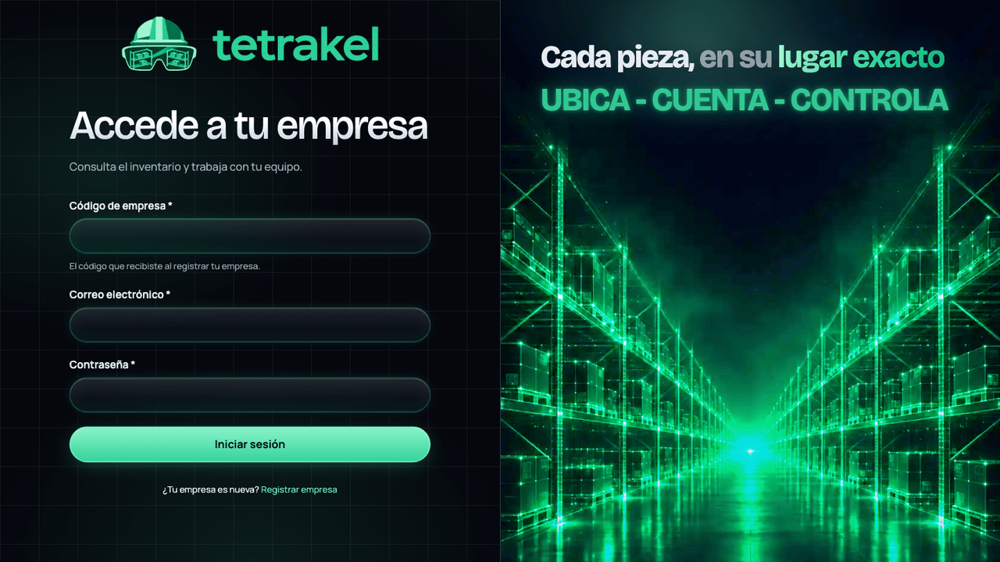
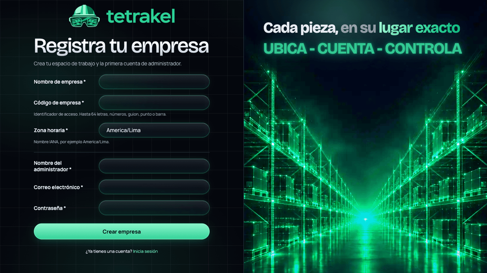

<div align="center">



### Cada pieza, en su lugar exacto

**Sistema de gestión de almacenes (WMS) con inventario por ubicación y visualización 3D.**


[Producto](#producto) · [Capturas](#capturas) · [Estado](#estado) · [Puesta en marcha](#puesta-en-marcha) · [Verificación](#verificación) · [Documentación](#documentación)

</div>

<br />

<p align="center">
  
</p>

## Producto

Tetrakel está pensado para empresas con almacenes de mediano y gran tamaño. Combina un inventario trazable con un editor configurable de zonas, pasillos, racks, niveles y ubicaciones, y con una vista 3D del almacén para consultar dónde está cada pieza.

| | |
|---|---|
| **Inventario** | Recepciones, movimientos, reservas, picking, despachos y traslados, con cantidades exactas por ubicación y unidad. |
| **Control** | Conteos, ajustes, bloqueos, historial de cada movimiento y reportes. |
| **Intercambio** | Importación y exportación CSV/XLSX. |
| **Distribución física** | Editor visual de zonas, racks, niveles y ubicaciones, y consulta en 3D. |
| **Modalidades** | SaaS con suscripción e infraestructura del proveedor, o instalación local en la infraestructura del cliente. |

El núcleo de negocio es compartido entre ambas modalidades. Los datos de demostración son sintéticos y los cobros, simulados en esta etapa.

El proyecto se construye con **Specification Driven Development (SDD)**: requisitos, contratos, plan, tareas y evidencia verificable antes de dar una capacidad por terminada.

## Capturas

<table>
  <tr>
    <td width="50%"></td>
    <td width="50%"></td>
  </tr>
  <tr>
    <td align="center"><sub>Acceso con la empresa, el correo y la contraseña.</sub></td>
    <td align="center"><sub>Registro de empresa y primer administrador.</sub></td>
  </tr>
</table>

## Estado

**141 de 214 tareas completadas.**

- **Backend:** acceso y equipo, almacenes, catálogo, geometría persistida, inventario, pedidos, reservas, picking, despachos, traslados, conteos y ajustes, reportes, archivos CSV/XLSX, avisos entre sesiones y datos de demostración con trazabilidad y aislamiento entre empresas.
- **Interfaz:** acceso, registro SaaS y configuración local, empresa y equipo, almacenes, catálogo e inventario. Incluye el nuevo diseño oscuro esmeralda y el borrador de distribución del editor (T141).
- **Pendiente:** el editor y visor 3D (desde T142), las pantallas de operaciones y reportes, y la landing.

Reportes e importación/exportación están disponibles por HTTP y tendrán su pantalla en un bloque posterior. Más detalle en el [estado del proyecto](docs/estado.md).

## Base técnica

| Área | Tecnología fijada |
|---|---|
| Runtime | Node.js 24.22.1 |
| Dependencias | pnpm 12.16.1, un único `pnpm-lock.yaml` |
| Web | Next.js 16.4.3, React 19.3.1, TypeScript |
| API | NestJS 12.3.2, ESM, TypeScript |
| Datos | PostgreSQL 18.6, pg y Drizzle |
| Interfaz | Radix, Tailwind, TanStack Query/Table, React Hook Form y Zod |
| Verificación | Vitest, Supertest, Playwright CLI, ESLint y TypeScript |

La instalación local no requiere cuentas de servicios en la nube. El [plan técnico](specs/001-wms-operativo-3d/plan.md) identifica también las tecnologías previstas para fases futuras.

## Puesta en marcha

Requisitos: Git, un Node existente para ejecutar los descargadores y Docker con Compose para PostgreSQL. Los helpers de runtime están preparados para macOS y Linux, ARM64 y x64; no se afirma compatibilidad probada en otras plataformas.

```sh
git clone https://github.com/Jair-Roman-Mauricio/PROJECT-TETRAKEL.git
cd PROJECT-TETRAKEL
node scripts/setup-runtime.mjs
node scripts/setup-pnpm.mjs
node scripts/pnpm-local.mjs install --frozen-lockfile
node scripts/setup-env.mjs
docker compose --env-file .env -f infra/compose.postgres.yml up -d --wait
node scripts/pnpm-local.mjs run db:roles
node scripts/pnpm-local.mjs run db:migrate
node scripts/pnpm-local.mjs run db:migrate --test
```

Los descargadores comprueban la integridad de las herramientas y las guardan en `.tools/`; no cambian instalaciones globales. `setup-env.mjs` genera credenciales aleatorias, conserva los valores existentes y completa los de provisión ausentes. **No subir `.env` al repositorio.**

### Ver la interfaz con datos ficticios

```sh
node scripts/pnpm-local.mjs run preview:local
```

Abre una instancia temporal con datos sintéticos y una base privada, e imprime la dirección de loopback. Al cerrarla con Ctrl+C se elimina esa base. La [guía local](docs/desarrollo.md#vista-previa-de-la-interfaz) explica las credenciales y el cierre. La carga de datos demo en una instalación es explícita: ver la [guía local](docs/desarrollo.md#demostración-explícita).

El despliegue de la aplicación en Railway requiere una indicación posterior expresa.

## Verificación

```sh
node scripts/pnpm-local.mjs run lint
node scripts/pnpm-local.mjs run typecheck
node scripts/pnpm-local.mjs run test:unit
node scripts/pnpm-local.mjs run test:integration
node scripts/pnpm-local.mjs run test:flows
node scripts/pnpm-local.mjs run test:flows --case t133 --local --empty
node scripts/pnpm-local.mjs run build
```

Si Node y pnpm ya coinciden con las versiones fijadas y están en `PATH`, se puede usar directamente `pnpm install --frozen-lockfile` y `pnpm run <script>`.

Las pruebas cubren reglas puras, persistencia, bloqueos concurrentes, rollback real, idempotencia, altas SaaS y locales, sesiones, permisos, acceso cruzado entre empresas, geometría, recepciones y movimientos, salidas parciales, traslados, ajustes y reconciliación de físico, reservado y tránsito. No acreditan todavía el WMS completo.

**Última ejecución completa:** 157 pruebas unitarias y 23 flujos de navegador aprobados, más lint, tipos y build. Los 191 casos de integración corresponden a la última ejecución registrada en la evidencia de las [fases 11–12](docs/evidencias/fase-11-12.md). Los flujos usan Chrome y PostgreSQL reales.

Evidencia por fase: [11–12](docs/evidencias/fase-11-12.md), [9–10](docs/evidencias/fase-09-10.md), [7–8](docs/evidencias/fase-07-08.md), [5–6](docs/evidencias/fase-05-06.md), [3–4](docs/evidencias/fase-03-04.md), [2](docs/evidencias/fase-02.md) y [1](docs/evidencias/fase-01.md), y la [migración a pnpm](docs/cambios/001-pnpm-github.md).

## Estructura

```text
apps/api/       API NestJS
apps/web/       Next.js: acceso y pantallas operativas
packages/       domain, contracts, database y ui
infra/          PostgreSQL local y roles separados
scripts/        Preparación y ejecución reproducible
tests/          Pruebas unitarias, integración y flujos de navegador
specs/          Requisitos, contratos, plan y 214 tareas
docs/           Arquitectura, guías, decisiones y evidencia
investigacion/  Investigación de mercado inicial
```

## Documentación

- [Índice documental](docs/README.md) y [estado del proyecto](docs/estado.md).
- [Constitución](docs/constitution.md) y [flujo SDD](docs/flujo-sdd.md).
- [Especificación](specs/001-wms-operativo-3d/spec.md), [contratos](specs/001-wms-operativo-3d/contratos.md), [plan](specs/001-wms-operativo-3d/plan.md) y [tareas](specs/001-wms-operativo-3d/tasks.md).
- [Arquitectura](docs/arquitectura.md), [persistencia y aislamiento](docs/persistencia.md), [índices y consultas](docs/reportes/consultas-fase-02.md), [desarrollo local](docs/desarrollo.md) y [contribución](CONTRIBUTING.md).
- [Investigación de mercado](investigacion/mercado-almacen-3d.md) y [referencias de diseño](specs/001-wms-operativo-3d/referencias-ui.md).

## Licencia

Pendiente de definición por el titular. La publicación del código no concede por sí sola una licencia de uso, modificación o distribución.
